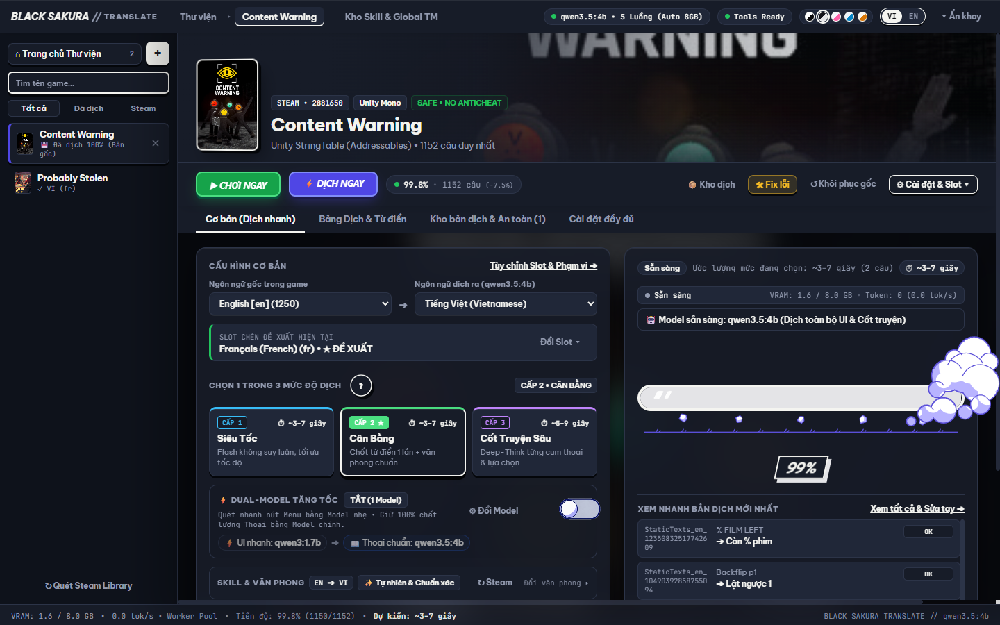
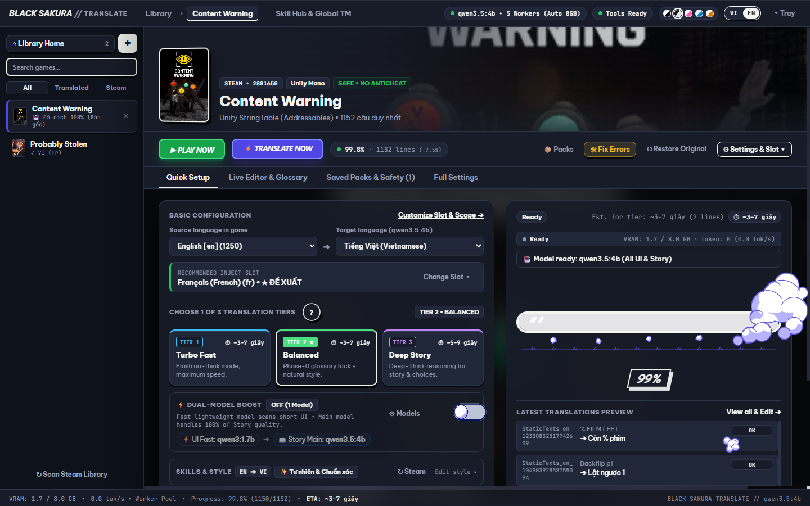
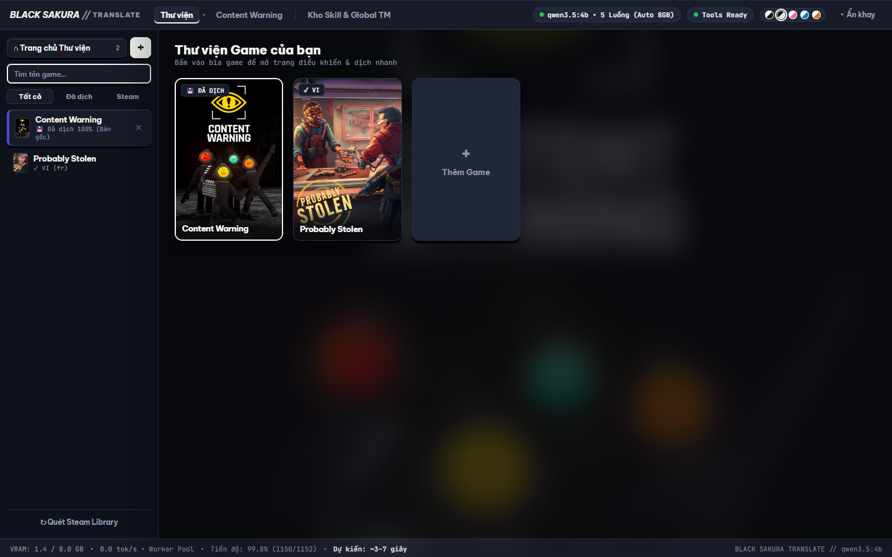

# Black Sakura Translate

[-ff5fa8?style=for-the-badge&logo=github)](https://github.com/hohieu112007-byte/black-sakura-translate/releases/latest)
[](LICENSE)

**Black Sakura Translate** là ứng dụng Việt hóa / đa ngôn ngữ hóa game PC **hoàn toàn miễn phí, chạy 100% AI cục bộ (Local AI qua Ollama)** với giao diện phong cách **Steam Desktop** hiện đại. Không cần API trả phí, không gửi dữ liệu ra máy chủ ngoài, bảo vệ file game gốc bằng hệ thống an toàn 6 lớp.

> **👉 Tải nhanh cho người dùng (không cần biết code):** Bấm nút **[TẢI APP NGAY (Release v1.0.0)](https://github.com/hohieu112007-byte/black-sakura-translate/releases/latest)** hoặc nhìn cột **Releases** bên phải trang GitHub -> tải **`Black-Sakura-Translate-v1.0.0-Windows-Standalone.zip`**, giải nén và nháy đúp **`BlackSakuraTranslate.exe`**!

---

## Ảnh chụp giao diện thực tế

### 1. Màn hình Điều khiển Game & Dịch nhanh (Theme *Obsidian Đêm*)


### 2. Bảng Dịch Trực Tiếp, Thay thế Hàng loạt & Từ điển Thuật ngữ


<details>
<summary><b>📸 Xem thêm ảnh: Giao diện Tiếng Anh (VI / EN), Thư viện Steam & Kho Skill 2 Lớp</b></summary>

#### Chế độ Tiếng Anh (nút chuyển nhanh `VI | EN` trên thanh trên cùng)


#### Thư viện Game phong cách Steam Poster 2:3


#### Kho Skill 2 Lớp & Quản lý Bộ công cụ GitHub (Theme *Sakuga Indigo*)


</details>

---

## Tính năng nổi bật

- **100% AI Local (Ollama) & Tự tối ưu phần cứng:** Tự chỉnh luồng/VRAM theo GPU; hỗ trợ **Dual-Model** (model nhẹ quét UI, model chính dịch thoại) và **Quiet Mode** (giảm nóng laptop & bảo vệ tai nghe USB).
- **Hỗ trợ đa Engine:** Unity (Mono/IL2CPP, Addressables `catalog.bin/.json`, tự đổi nhãn *Tiếng Việt*), Unreal Engine (`.locres`, `.pak`), Ren'Py (`.rpy`, `.rpa`), JSON, CSV, PO, YAML, XML, TXT.
- **Kho Skill 2 Lớp & Suy luận Pha 0:** 17 Skill dựng sẵn (Cầu ngôn ngữ + Văn phong), tự lập Từ điển Thuật ngữ, chống trùng lặp + Global TM 0ms.
- **Live Editor & Ghi nóng:** Tìm kiếm toàn DB, lọc theo loại câu, thay thế hàng loạt bảo vệ thẻ code và ghi thẳng vào game trong vài giây.
- **Chia sẻ `.sakugapack` & Delta Update:** Xuất/nhập bản dịch 1-Click; tự giữ bản dịch cũ và chỉ dịch câu mới khi Steam cập nhật game.
- **An toàn 6 Lớp & Giao diện song ngữ `VI / EN`:** Chặn game online có Anti-Cheat, sao lưu gốc SHA-256 khôi phục 1-Click, Tag Firewall, vá Font Unicode, chạy ngầm khay hệ thống.

---

## Yêu cầu hệ thống

- **Hệ điều hành:** Windows 10 / 11 (64-bit).
- **Python:** 3.10 trở lên (tải tại [python.org](https://www.python.org/downloads/), nhớ tích chọn *Add Python to PATH*).
- **Ollama:** Đã cài đặt và đang chạy cục bộ (tải tại [ollama.com](https://ollama.com/)).
- **Phần cứng khuyến nghị:** GPU NVIDIA 6GB–8GB+ VRAM (hoặc RAM 16GB+ khi chạy CPU).
  - Model khuyến nghị: `qwen3.5:4b` (model chính) và tùy chọn `qwen3:1.7b` (model phụ cho Dual-Model UI).

---

## Cài đặt & Khởi chạy nhanh

### Cách 1: Tải bản Độc lập `.EXE` (Không cần cài Python — Khuyên dùng!)
1. Mở trang **[Releases mới nhất](https://github.com/hohieu112007-byte/black-sakura-translate/releases/latest)** và tải file **`Black-Sakura-Translate-v1.0.0-Windows-Standalone.zip`**.
2. Giải nén ra bất kỳ thư mục nào và nháy đúp **`BlackSakuraTranslate.exe`**.
3. Cài **[Ollama](https://ollama.com/download)** (nếu máy chưa có) — ngay khi mở app, thanh thiết lập 1-Click sẽ tự hiện để bạn bấm **▶ Mở Ollama ngay** và **⬇ Tải ngay `qwen3.5:4b` & Tự kết nối**.

### Cách 2: Chạy bản Portable / Mã nguồn (Nếu máy có Python 3.10+)
1. Tải **`Black-Sakura-Translate-v1.0.0-Source.zip`** tại mục Releases (hoặc `git clone` bên dưới) rồi giải nén.
2. Nháy đúp **`Start_Black_Sakura_Translate.bat`** — script tự cài các thư viện trong `requirements.txt` nếu thiếu và mở ứng dụng.

### Cách 3: Chạy bằng dòng lệnh (CLI cho Developer)
```bash
git clone https://github.com/hohieu112007-byte/black-sakura-translate.git
cd black-sakura-translate
pip install -r requirements.txt
python app.py
```

#### Tùy chọn dòng lệnh nâng cao
- Chạy trên trình duyệt web mặc định thay vì cửa sổ Desktop PyWebView:
  ```bash
  python app.py --web
  ```
- Chọn cổng cục bộ ưu tiên (mặc định `8765`):
  ```bash
  python app.py --port 8765
  ```

> **Lưu ý lần chạy đầu:** Ứng dụng sẽ tự động tạo các thư mục làm việc (`backups/`, `cache/`, `covers/`, `tools/`) và tải các công cụ mã nguồn mở cần thiết (`repak`, `UnrealLocres`, `rpatool.py`, font Unicode `NotoSans` / `BeVietnamPro`) từ GitHub Releases về thư mục `tools/`.

---

## Tài liệu hướng dẫn sử dụng chi tiết

Xem file văn bản tiếng Việt chi tiết đi kèm ngay trong thư mục gốc:
- **[HUONG_DAN_SU_DUNG.txt](HUONG_DAN_SU_DUNG.txt)** — Hướng dẫn từng bước từ cài đặt, thêm game, chọn chế độ dịch, sửa tay, chia sẻ `.sakugapack` đến xử lý lỗi thường gặp.

---

## Cấu trúc dự án

```text
.
├── app.py                          # FastAPI backend, SSE realtime stream & PyWebView launcher
├── requirements.txt                # Danh sách thư viện Python
├── Start_Black_Sakura_Translate.bat# Script khởi chạy nhanh trên Windows
├── HUONG_DAN_SU_DUNG.txt           # File văn bản hướng dẫn sử dụng chi tiết (Tiếng Việt)
├── core/                           # AI Engine (Ollama), Hardware Profiler, SQLite DB, Skill Manager, Tray
├── extractors/                     # Bộ trích xuất & đóng gói Unity, Unreal (.locres/.pak), Ren'Py, JSON/CSV/PO/YAML
├── safety_shield/                  # 6 lớp bảo vệ: Anti-Cheat, Backup SHA-256, Tag Firewall, QA Guard, Font Patcher
├── skills/                         # 17 Skill dựng sẵn (languages/ + styles/)
└── frontend/                       # Giao diện Steam-Style (5 theme, Live Editor, Skill Hub, Dual-Model UI)
```

---

## Miễn trừ trách nhiệm

Công cụ này phục vụ mục đích học tập, nghiên cứu và cá nhân hóa ngôn ngữ chơi game offline/single-player. Không sử dụng để can thiệp file của các trò chơi trực tuyến có hệ thống chống gian lận (Anti-Cheat). Người dùng tự chịu trách nhiệm tuân thủ điều khoản sử dụng của từng trò chơi.

## Giấy phép

Phát hành theo giấy phép **MIT License** — xem chi tiết tại file [LICENSE](LICENSE).
